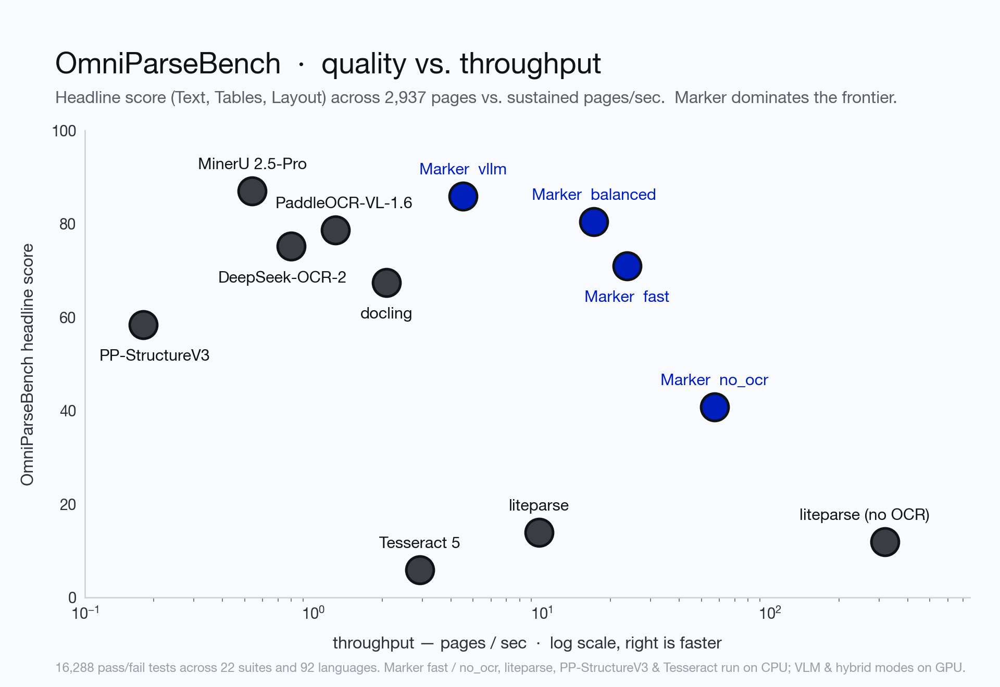
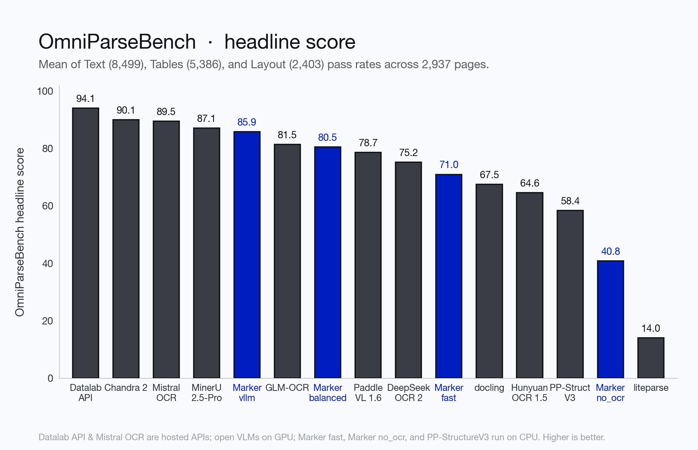
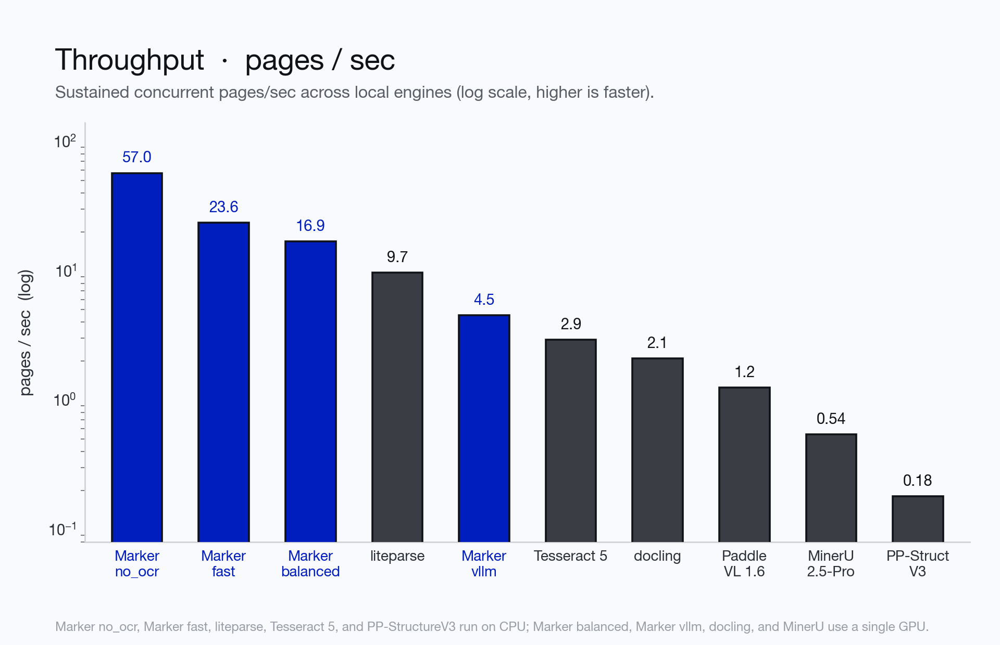
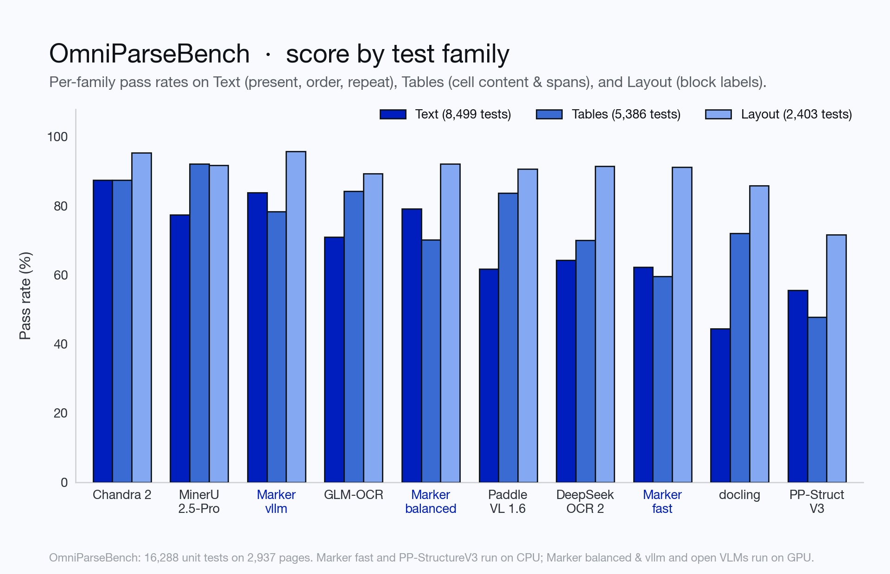
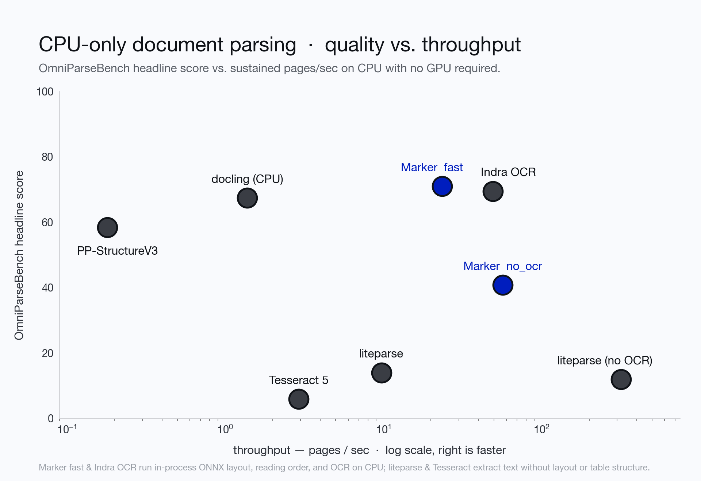
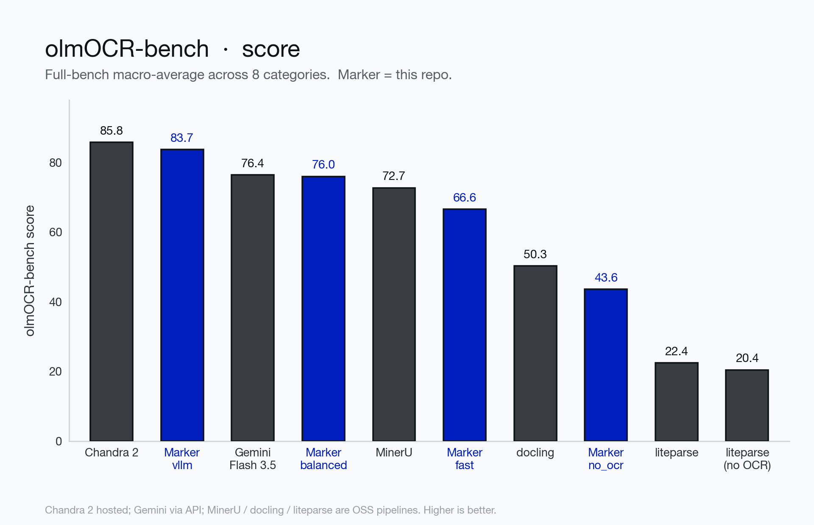
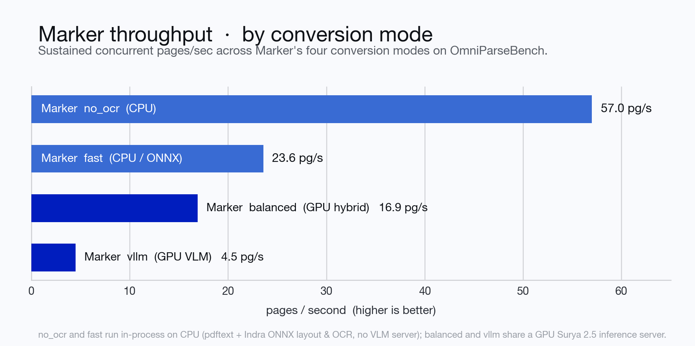

<p align="center">
  
</p>
<h1 align="center">Datalab</h1>
<p align="center">
  <strong>State of the Art models for Document Intelligence</strong>
</p>
<p align="center">
  <a href="https://www.apache.org/licenses/LICENSE-2.0"></a>
  <a href="https://www.datalab.to/pricing"></a>
  <a href="https://discord.gg/KuZwXNGnfH"></a>
</p>
<p align="center">
  <a href="https://www.datalab.to"></a>
  <a href="https://documentation.datalab.to"></a>
  <a href="https://www.datalab.to/playground"></a>
</p>

<hr/>

# Marker

Marker converts documents to markdown, JSON, chunks, and HTML quickly and accurately.

- Converts PDF, image, PPTX, DOCX, XLSX, HTML, EPUB files in all languages
- Formats tables, forms, equations, inline math, links, references, and code blocks
- Extracts and saves images
- Removes headers/footers/other artifacts
- Extensible with your own formatting and logic
- Optionally boost accuracy with LLMs (and your own prompt)
- Works on GPU, CPU, or MPS

## Try Datalab's Managed Platform

Our managed platform uses [Chandra](https://github.com/datalab-to/chandra), our latest open source model, and other models — higher accuracy than Marker, with opt-in zero data retention, SOC 2 Type 2, and custom BAAs.

If you have high volume workloads, we offer a batch processing service that has processed 1B+ pages in a day at peak — we manage the infrastructure so your workloads finish on time.

The Datalab API turns documents into verifiable knowledge your agents act on. Every result traces back to its page and position, and one API can parse, extract, fill and edit documents.

Get started with **about 5,000 free convert pages every month** (work email) — [sign up](https://www.datalab.to/?utm_source=gh-marker).

## Performance



Marker is built around a simple premise: **you shouldn't have to choose between VLM-level accuracy and production throughput, or maintain separate tools for GPU and CPU.**

On [OmniParseBench](https://huggingface.co/datasets/datalab-to/omni_parse_bench) ([GitHub](https://github.com/datalab-to/omni_parse_bench)) — **16,288 pass/fail unit tests across 2,937 pages** in 92 languages covering text & reading order (`8,499` tests), table cell structure (`5,386` tests), and block layout (`2,403` tests) — as well as [olmOCR-bench](https://github.com/allenai/olmocr/tree/main/olmocr/bench), Marker defines the Pareto frontier across every hardware tier:

- **Faster and more accurate than open document pipelines (`MinerU`, `docling`, `PP-StructureV3`)**:
  - **`Marker balanced`** (**80.5** OmniParseBench, **85.6** on the olmOCR-bench suites, **16.9 pg/s**) beats **`docling`** (`67.5` at `2.1 pg/s`) by **+13.0 points overall** (**+34.8 points on text & math**) at **8× the speed**, and runs **31× faster** than **`MinerU 2.5-Pro`** (`0.54 pg/s`).
  - **`Marker vllm`** (**85.9** OmniParseBench, **83.7** olmOCR-bench, **4.5 pg/s**) delivers higher text accuracy (`83.8` vs `77.4`) and higher layout accuracy (`95.7` vs `91.7`) than **`MinerU 2.5-Pro`** at **8.3× the throughput** (`4.5` vs `0.54 pg/s`).
- **Outperforms open VLMs 2–12× its size (`GLM-OCR`, `LightOnOCR-3-4B`, `PaddleOCR-VL-1.6`, `DeepSeek-OCR-2`, `olmOCR-2`)**:
  - Full-page VLMs burn GPU compute on every single page — even clean born-digital PDFs. Marker's hybrid **`balanced`** mode keeps clean prose on CPU (`pdftext` + in-process [Indra ONNX](https://github.com/datalab-to/indra-ocr) layout) and only calls the GPU VLM on equations, complex tables, CJK/non-Latin scripts, and scans — outscoring **`PaddleOCR-VL-1.6`** (`78.7`) and **`DeepSeek-OCR-2`** (`75.2`, 3.4B) at **14–21× higher throughput**.
  - When you want full VLM OCR on every page, **`Marker vllm`** (powered by the compact 0.69B [Surya 2.5](https://github.com/datalab-to/surya) VLM) scores **85.9**, beating 1B–8B open VLMs (`LightOnOCR-3-4B` `82.9`, `GLM-OCR` `81.5`, `PaddleOCR-VL-1.6` `78.7`, `DeepSeek-OCR-2` `75.2`, `HunyuanOCR-1.5` `64.6`, `olmOCR-2` `42.6`).
- **Best-in-class CPU-only parsing (`fast` & `no_ocr`) — no GPU or server required**:
  - **`Marker fast`** runs 100% in-process on CPU/MPS (~18 MB Indra ONNX weights) and scores **71.0** at **23.6 pg/s** — beating **`docling`** (`67.5`) at **11–17× the speed**, beating 1B GPU VLMs like **`HunyuanOCR-1.5`** (`64.6`), outscoring **`PaddleOCR PP-StructureV3`** (`58.4`) by **+12.6 points at >130× the speed**, and delivering **5× higher accuracy at 2.4× the speed** of **`liteparse`** (`14.0` at `9.7 pg/s`) and **12× higher accuracy at 8× the speed** of **`Tesseract 5`** (`5.9` at `2.9 pg/s`).
  - **`Marker no_ocr`** runs at **57.0 pg/s** on CPU with zero OCR calls, combining `pdftext` with Indra ONNX layout and CPU table reconstruction to score **81–83%** on born-digital multi-column and document suites (**3.4× higher overall** than `liteparse --no-ocr` at `40.8` vs `12.0`).

### Which mode should I use?

| Mode | Hardware | Throughput | OmniParseBench | Best for |
|---|---|---:|---:|---|
| `--mode balanced` *(GPU default)* | GPU + CPU | **16.9 pg/s** | **80.5** *(85.6 olmOCR suites)* | Production mixed workloads (born-digital PDFs, tables, math, CJK, and scans) |
| `--mode vllm` | GPU | **4.5 pg/s** | **85.9** *(83.7 olmOCR-bench)* | Maximum accuracy on degraded scans, dense equations, handwriting, & complex tables |
| `--mode fast` *(CPU/MPS default)* | CPU / MPS only | **23.6 pg/s** | **71.0** *(71.6 born-digital)* | Laptops, CI, serverless/CPU containers, and fast local OCR with zero GPU dependencies |
| `--mode no_ocr` | CPU only | **57.0 pg/s** | **40.8** *(82.7 digital docs)* | Bulk born-digital PDFs when you want layout, reading order, & tables at maximum speed |



See [below](#benchmarks) for the full OmniParseBench and olmOCR-bench tables, per-suite breakdowns, and instructions on how to run your own benchmarks.

## Hybrid Mode

For the highest accuracy, pass the `--use_llm` flag to use an LLM alongside marker.  This will do things like merge tables across pages, handle inline math, format tables properly, and extract values from forms.  It works with Gemini, Claude, OpenAI-compatible, Azure, Vertex, OpenRouter, or Ollama models.  By default, it uses `gemini-3.5-flash`.  See [below](#llm-services) for details.

## Examples

| PDF | File type | Markdown                                                                                                                     | JSON                                                                                                   |
|-----|-----------|------------------------------------------------------------------------------------------------------------------------------|--------------------------------------------------------------------------------------------------------|
| [Think Python](https://greenteapress.com/thinkpython/thinkpython.pdf) | Textbook | [View](https://github.com/datalab-to/marker/blob/master/data/examples/markdown/thinkpython/thinkpython.md)                 | [View](https://github.com/datalab-to/marker/blob/master/data/examples/json/thinkpython.json)         |
| [Switch Transformers](https://arxiv.org/pdf/2101.03961.pdf) | arXiv paper | [View](https://github.com/datalab-to/marker/blob/master/data/examples/markdown/switch_transformers/switch_trans.md) | [View](https://github.com/datalab-to/marker/blob/master/data/examples/json/switch_trans.json) |
| [Multi-column CNN](https://arxiv.org/pdf/1804.07821.pdf) | arXiv paper | [View](https://github.com/datalab-to/marker/blob/master/data/examples/markdown/multicolcnn/multicolcnn.md)                 | [View](https://github.com/datalab-to/marker/blob/master/data/examples/json/multicolcnn.json)         |

# Commercial usage

Our code is licensed under **Apache 2.0** — free to use, including commercially. Our model weights use a modified AI Pubs Open Rail-M license (free for research, personal use, and startups under $5M funding/revenue). For commercial use of the model weights beyond that, visit our pricing page [here](https://www.datalab.to/pricing?utm_source=gh-marker).

# Community

[Discord](https://discord.gg//KuZwXNGnfH) is where we discuss future development.

# Installation

You'll need python 3.10+ and [PyTorch](https://pytorch.org/get-started/locally/).

Install with:

```shell
pip install marker-pdf
```

If you want to use marker on documents other than PDFs, you will need to install additional dependencies with:

```shell
pip install marker-pdf[full]
```

## Inference backend prerequisites

Surya auto-spawns the server on first use, and you need `vllm` (NVIDIA GPU) or `llama.cpp` (CPU / Apple Silicon):

- **NVIDIA GPU:** [Docker](https://docs.docker.com/get-docker/) plus the [NVIDIA Container Toolkit](https://docs.nvidia.com/datacenter/cloud-native/container-toolkit/latest/install-guide.html).
- **CPU / Apple Silicon:** the `llama-server` binary from llama.cpp:
  ```shell
  brew install llama.cpp     # macOS
  # or grab a release from https://github.com/ggml-org/llama.cpp/releases
  ```

# Usage

First, some configuration:

- **Mode** (`--mode no_ocr|fast|balanced|vllm`; defaults by device — `balanced` on GPU, `fast` on CPU/MPS):
  - `no_ocr` (or `--disable_ocr`) uses the embedded PDF text layer + in-process Indra ONNX layout and reading order on CPU with zero OCR calls (`~24–33 pg/s`).
  - `fast` (aliased as `indra`; default on **CPU / Apple Silicon MPS**) uses in-process Indra ONNX layout, reading order, and line/page ONNX OCR (`~33 pg/s` on digital PDFs, `~7.4 pg/s` mixed) — no external VLM server required.
  - `balanced` (default on **GPU**) uses smart routing: `pdftext` + Indra ONNX layout on clean Latin prose pages, and routes equations, inline math, complex tables, CJK/non-Latin scripts, and scanned/garbled pages to the Surya 2.5 VLM.
  - `vllm` (aliased as `surya` / `accurate`) runs full-page Surya 2.5 VLM OCR on every page, skipping `pdftext` and Indra entirely.
- In `balanced` and `vllm` modes, Marker runs VLM OCR through a local Surya inference server spawned automatically on first use — vLLM (Docker) on NVIDIA GPUs, llama.cpp elsewhere.  You can also point marker at an already-running server with `SURYA_INFERENCE_URL=http://host:port/v1`.
- Useful server settings (all surya env vars): `SURYA_INFERENCE_BACKEND` (`vllm` or `llamacpp`), `SURYA_INFERENCE_PARALLEL` (concurrent requests — by default this auto-scales to the server's capacity: the GPU's `max_num_seqs` under vllm, a conservative slot count under llama.cpp; set an int only to override), `SURYA_INFERENCE_KEEP_ALIVE` (keep the server running between invocations), `VLLM_GPUS` (GPU indices for the server).
- Some PDFs, even digital ones, have bad text in them.  Set `--force_ocr` to force OCR on all pages, or the `strip_existing_ocr` to keep all digital text, and strip out any existing OCR text.
- Inline math is converted to LaTeX automatically in balanced mode (`ocr_inline_math`); in fast mode, set `--force_ocr` or `--ocr_inline_math` to get the same.

## Interactive Viewer App

Marker includes a built-in interactive web viewer (no extra dependencies required) that lets you drop in PDFs, images, or Office documents and inspect layout blocks, reading order, text lines, stage timings, and rendered Markdown, HTML, Chunks, and JSON page by page across all conversion modes (`no_ocr`, `fast`, `balanced`, `vllm`). Run it with:

```shell
marker_gui --port 8000
```

Then open `http://localhost:8000` in your browser (pass `--streamlit` if you want the legacy Streamlit UI).

## Convert a single file

```shell
marker_single /path/to/file.pdf
```

You can pass in PDFs or images.

Options:
- `--mode [auto|no_ocr|fast|balanced|vllm]`: Conversion mode (see above). Defaults by device: `balanced` on GPU, `fast` on CPU/MPS.
- `--stdout`: Write the converted Markdown/JSON/HTML/Chunks directly to stdout instead of saving to a directory (ideal for shell pipelines and AI agents).
- `--disable_ocr`: Never call the VLM - pure text-layer extraction (equations and scanned pages are skipped).
- `--page_range TEXT`: Specify which pages to process. Accepts comma-separated page numbers and ranges. Example: `--page_range "0,5-10,20"` will process pages 0, 5 through 10, and page 20.
- `--output_format [markdown|json|html|chunks]`: Specify the format for the output results.
- `--output_dir PATH`: Directory where output files will be saved. Defaults to the value specified in settings.OUTPUT_DIR.
- `--paginate_output`: Paginates the output, using `\n\n{PAGE_NUMBER}` followed by `-` * 48, then `\n\n`
- `--use_llm`: Uses an LLM to improve accuracy.  You will need to configure the LLM backend - see [below](#llm-services).
- `--force_ocr`: Force OCR processing on the entire document, even for pages that might contain extractable text.
- `--block_correction_prompt`: if LLM mode is active, an optional prompt that will be used to correct the output of marker.  This is useful for custom formatting or logic that you want to apply to the output.
- `--strip_existing_ocr`: Remove all existing OCR text in the document and re-OCR with surya.
- `--redo_inline_math`: If you want the absolute highest quality inline math conversion, use this along with `--use_llm`.
- `--disable_image_extraction`: Don't extract images from the PDF.  If you also specify `--use_llm`, then images will be replaced with a description.
- `--keep_headers_footers` (or `--keep_pageheader_in_output` / `--keep_pagefooter_in_output`): Keep running page headers / footers in the output instead of stripping them (they are removed by default).
- `--keep_server`: Keep the Surya inference server (vLLM / llama.cpp) running after this command exits so subsequent CLI commands reuse it.
- `--skill` / `--install_skill PATH`: Print the Marker AI coding agent skill (`SKILL.md`) to stdout or install it into a skills directory (e.g. `marker_single --install_skill .agents/skills`).
- `--debug`: Enable debug mode for additional logging and diagnostic information.
- `--processors TEXT`: Override the default processors by providing their full module paths, separated by commas. Example: `--processors "module1.processor1,module2.processor2"`
- `--config_json PATH`: Path to a JSON configuration file containing additional settings.
- `config --help`: List all available builders, processors, and converters, and their associated configuration.  These values can be used to build a JSON configuration file for additional tweaking of marker defaults.
- `--converter_cls`: One of `marker.converters.pdf.PdfConverter` (default) or `marker.converters.table.TableConverter`.  The `PdfConverter` will convert the whole PDF, the `TableConverter` will only extract and convert tables.
- `--llm_service`: Which llm service to use if `--use_llm` is passed.  This defaults to `marker.services.gemini.GoogleGeminiService`.
- `--help`: see all of the flags that can be passed into marker.  (it supports many more options then are listed above)

OCR runs through the surya VLM, which is multilingual - see the [surya README](https://github.com/datalab-to/surya) for details.  If you don't need OCR, marker can work with any language.

## Convert multiple files

```shell
marker /path/to/input/folder
```

- `marker` supports all the same options from `marker_single` above.
- `--workers` is the number of conversion workers to run simultaneously.  This is automatically set by default, but you can increase it to increase throughput, at the cost of more CPU usage.  All workers share a single inference server, which the parent process spawns.
- The parent budgets total VLM concurrency automatically: it reads the server's capacity and splits it across workers (aggregate in-flight ≈ 1.5× capacity), so adding workers never over-queues the server.  Set `SURYA_INFERENCE_PARALLEL` yourself only to override.
- With `--disable_ocr` no inference server is started at all, and the pool is sized purely by CPU cores.
- `--skip_existing` skips input files that already have output in `--output_dir` (resume a run); `--max_files N` caps how many files are converted; `--disable_multiprocessing` runs everything in one process.

### Batch sizing cheat sheet (e.g. 1000 docs)

- **One GPU machine**: `marker /folder --output_dir out` — defaults handle it: one vllm server, a CPU-sized worker pool, concurrency budgeted to the GPU.  Add `--mode fast` if you want cheaper/faster conversion for mostly-digital corpora.
- **Multi-GPU machine**: same single command, with the server spanning GPUs: `VLLM_GPUS=0,1,2,3 marker /folder ...`
- **Multiple machines**: shard the file list — run one `marker` per node with `--num_chunks <nodes> --chunk_idx <this node>`.  Each node spawns its own server.
- **CPU-only / no VLM**: `marker /folder --disable_ocr` (pure text-layer extraction; equations and scanned pages are skipped).

## Use from python

See the `PdfConverter` class at `marker/converters/pdf.py` function for additional arguments that can be passed.

```python
from marker.converters.pdf import PdfConverter
from marker.models import create_model_dict
from marker.output import text_from_rendered

converter = PdfConverter(
    artifact_dict=create_model_dict(),
)
rendered = converter("FILEPATH")
text, _, images = text_from_rendered(rendered)
```

`rendered` will be a pydantic basemodel with different properties depending on the output type requested.  With markdown output (default), you'll have the properties `markdown`, `metadata`, and `images`.  For json output, you'll have `children`, `block_type`, and `metadata`.

### Custom configuration

You can pass configuration using the `ConfigParser`.  To see all available options, do `marker_single --help`.

```python
from marker.converters.pdf import PdfConverter
from marker.models import create_model_dict
from marker.config.parser import ConfigParser

config = {
    "output_format": "json",
    "ADDITIONAL_KEY": "VALUE"
}
config_parser = ConfigParser(config)

converter = PdfConverter(
    config=config_parser.generate_config_dict(),
    artifact_dict=create_model_dict(),
    processor_list=config_parser.get_processors(),
    renderer=config_parser.get_renderer(),
    llm_service=config_parser.get_llm_service()
)
rendered = converter("FILEPATH")
```

### Extract blocks

Each document consists of one or more pages.  Pages contain blocks, which can themselves contain other blocks.  It's possible to programmatically manipulate these blocks.

Here's an example of extracting all forms from a document:

```python
from marker.converters.pdf import PdfConverter
from marker.models import create_model_dict
from marker.schema import BlockTypes

converter = PdfConverter(
    artifact_dict=create_model_dict(),
)
document = converter.build_document("FILEPATH")
forms = document.contained_blocks((BlockTypes.Form,))
```

Look at the processors for more examples of extracting and manipulating blocks.

## Other converters

You can also use other converters that define different conversion pipelines:

### Extract tables

The `TableConverter` will only convert and extract tables:

```python
from marker.converters.table import TableConverter
from marker.models import create_model_dict
from marker.output import text_from_rendered

converter = TableConverter(
    artifact_dict=create_model_dict(),
)
rendered = converter("FILEPATH")
text, _, images = text_from_rendered(rendered)
```

This takes all the same configuration as the PdfConverter.  You can specify the configuration `force_layout_block=Table` to avoid layout detection and instead assume every page is a table.  Tables are emitted as HTML (`<table>`) blocks; `output_format=json` gives you the table blocks with their page bounding boxes.

You can also run this via the CLI with
```shell
marker_single FILENAME --use_llm --force_layout_block Table --converter_cls marker.converters.table.TableConverter --output_format json
```

### OCR Only

If you only want to run OCR, you can also do that through the `OCRConverter`.  Set `--keep_chars` to keep individual characters and bounding boxes (digital PDFs only - pages that go through the VLM return block-level HTML without character boxes).

```python
from marker.converters.ocr import OCRConverter
from marker.models import create_model_dict

converter = OCRConverter(
    artifact_dict=create_model_dict(),
)
rendered = converter("FILEPATH")
```

This takes all the same configuration as the PdfConverter.

You can also run this via the CLI with
```shell
marker_single FILENAME --converter_cls marker.converters.ocr.OCRConverter
```

# Output Formats

## Markdown

Markdown output will include:

- image links (images will be saved in the same folder)
- formatted tables
- embedded LaTeX equations (fenced with `$$`)
- Code is fenced with triple backticks
- Superscripts for footnotes

## HTML

HTML output is similar to markdown output:

- Images are included via `img` tags
- equations are fenced with `<math>` tags
- code is in `pre` tags

## JSON

JSON output will be organized in a tree-like structure, with the leaf nodes being blocks.  Examples of leaf nodes are a single list item, a paragraph of text, or an image.

The output will be a list, with each list item representing a page.  Each page is considered a block in the internal marker schema.  There are different types of blocks to represent different elements.

Pages have the keys:

- `id` - unique id for the block.
- `block_type` - the type of block. The possible block types can be seen in `marker/schema/__init__.py`.  As of this writing, they are ["Line", "Span", "FigureGroup", "TableGroup", "ListGroup", "PictureGroup", "Page", "Caption", "Code", "Figure", "Footnote", "Form", "Equation", "Handwriting", "TextInlineMath", "ListItem", "PageFooter", "PageHeader", "Picture", "SectionHeader", "Table", "Text", "TableOfContents", "Document"]
- `html` - the HTML for the page.  Note that this will have recursive references to children.  The `content-ref` tags must be replaced with the child content if you want the full html.  You can see an example of this at `marker/output.py:json_to_html`.  That function will take in a single block from the json output, and turn it into HTML.
- `polygon` - the 4-corner polygon of the page, in (x1,y1), (x2,y2), (x3, y3), (x4, y4) format.  (x1,y1) is the top left, and coordinates go clockwise.
- `children` - the child blocks.

The child blocks have two additional keys:

- `section_hierarchy` - indicates the sections that the block is part of.  `1` indicates an h1 tag, `2` an h2, and so on.
- `images` - base64 encoded images.  The key will be the block id, and the data will be the encoded image.

Note that child blocks of pages can have their own children as well (a tree structure).

```json
{
      "id": "/page/10/Page/366",
      "block_type": "Page",
      "html": "<content-ref src='/page/10/SectionHeader/0'></content-ref><content-ref src='/page/10/SectionHeader/1'></content-ref><content-ref src='/page/10/Text/2'></content-ref><content-ref src='/page/10/Text/3'></content-ref><content-ref src='/page/10/Figure/4'></content-ref><content-ref src='/page/10/SectionHeader/5'></content-ref><content-ref src='/page/10/SectionHeader/6'></content-ref><content-ref src='/page/10/TextInlineMath/7'></content-ref><content-ref src='/page/10/TextInlineMath/8'></content-ref><content-ref src='/page/10/Table/9'></content-ref><content-ref src='/page/10/SectionHeader/10'></content-ref><content-ref src='/page/10/Text/11'></content-ref>",
      "polygon": [[0.0, 0.0], [612.0, 0.0], [612.0, 792.0], [0.0, 792.0]],
      "children": [
        {
          "id": "/page/10/SectionHeader/0",
          "block_type": "SectionHeader",
          "html": "<h1>Supplementary Material for <i>Subspace Adversarial Training</i> </h1>",
          "polygon": [
            [217.845703125, 80.630859375], [374.73046875, 80.630859375],
            [374.73046875, 107.0],
            [217.845703125, 107.0]
          ],
          "children": null,
          "section_hierarchy": {
            "1": "/page/10/SectionHeader/1"
          },
          "images": {}
        },
        ...
        ]
    }


```

## Chunks

Chunks format is similar to JSON, but flattens everything into a single list instead of a tree.  Only the top level blocks from each page show up. It also has the full HTML of each block inside, so you don't need to crawl the tree to reconstruct it.  This enable flexible and easy chunking for RAG.

## Metadata

All output formats will return a metadata dictionary, with the following fields:

```json
{
    "table_of_contents": [
      {
        "title": "Introduction",
        "heading_level": 1,
        "page_id": 0,
        "polygon": [...]
      }
    ], // computed PDF table of contents
    "page_stats": [
      {
        "page_id":  0,
        "text_extraction_method": "pdftext",
        "block_counts": [("Span", 200), ...]
      },
      ...
    ]
}
```

# LLM Services

When running with the `--use_llm` flag, you have a choice of services you can use:

- `Gemini` - this will use the Gemini developer API by default.  You'll need to pass `--gemini_api_key` to configuration.
- `Google Vertex` - this will use vertex, which can be more reliable.  You'll need to pass `--vertex_project_id`.  To use it, set `--llm_service=marker.services.vertex.GoogleVertexService`.
- `Ollama` - this will use local models.  You can configure `--ollama_base_url` and `--ollama_model`. To use it, set `--llm_service=marker.services.ollama.OllamaService`.
- `Claude` - this will use the anthropic API.  You can configure `--claude_api_key`, and `--claude_model_name`.  To use it, set `--llm_service=marker.services.claude.ClaudeService`.
- `OpenAI` - this supports any openai-like endpoint. You can configure `--openai_api_key`, `--openai_model`, and `--openai_base_url`. To use it, set `--llm_service=marker.services.openai.OpenAIService`.
- `Azure OpenAI` - this uses the Azure OpenAI service. You can configure `--azure_endpoint`, `--azure_api_key`, and `--deployment_name`. To use it, set `--llm_service=marker.services.azure_openai.AzureOpenAIService`.
- `OpenRouter` - this uses [OpenRouter](https://openrouter.ai)'s OpenAI-compatible API.  You can configure `--openrouter_api_key` (or the `OPENROUTER_API_KEY` env var), `--openrouter_model` (default `google/gemini-3.5-flash`), and `--openrouter_base_url`.  To use it, set `--llm_service=marker.services.openrouter.OpenRouterService`.

These services may have additional optional configuration as well - you can see it by viewing the classes.

# Internals

Marker is easy to extend.  The core units of marker are:

- `Providers`, at `marker/providers`.  These provide information from a source file, like a PDF.
- `Builders`, at `marker/builders`.  These generate the initial document blocks and fill in text, using info from the providers.
- `Processors`, at `marker/processors`.  These process specific blocks, for example the table formatter is a processor.
- `Renderers`, at `marker/renderers`. These use the blocks to render output.
- `Schema`, at `marker/schema`.  The classes for all the block types.
- `Converters`, at `marker/converters`.  They run the whole end to end pipeline.

To customize processing behavior, override the `processors`.  To add new output formats, write a new `renderer`.  For additional input formats, write a new `provider.`

Processors and renderers can be directly passed into the base `PDFConverter`, so you can specify your own custom processing easily.

## API server & Viewer

You can run the Marker FastAPI server and interactive viewer like this:

```shell
pip install -U uvicorn fastapi python-multipart
marker_server --port 8001
```

This starts a server at `http://localhost:8001` (use `--host` to change the bind address):
- Visit `http://localhost:8001/` in your browser for the interactive **Marker Viewer**.
- Visit `http://localhost:8001/docs` for the OpenAPI / Swagger documentation.

You can send programmatic conversion requests to `/marker` or `/marker/upload`:

```python
import requests
import json

post_data = {
    'filepath': 'FILEPATH',
    # Accepted params: page_range, mode, force_ocr, disable_ocr, use_llm,
    # strip_existing_ocr, keep_headers_footers, paginate_output, output_format
}

requests.post("http://localhost:8001/marker", data=json.dumps(post_data)).json()
```

Note that this server is intended for local inspection and small-scale use. If you want a production-grade conversion API with high concurrency, try the hosted [Datalab API](https://www.datalab.to/plans?utm_source=gh-marker).

# Troubleshooting

There are some settings that you may find useful if things aren't working the way you expect:

- If you have issues with accuracy, try setting `--use_llm` to use an LLM to improve quality.  You must set `GOOGLE_API_KEY` to a Gemini API key for this to work.
- Make sure to set `force_ocr` if you see garbled text - this will re-OCR the document.
- `TORCH_DEVICE` - set this to force the small local models (ocr error detection) onto a given torch device.  The VLM runs in the inference server - control its placement with `SURYA_INFERENCE_BACKEND` / `VLLM_GPUS`.
- If you're getting out of memory errors, decrease worker count.  You can also try splitting up long PDFs into multiple files.
- For hard documents or large volumes, try the hosted [Datalab API](https://www.datalab.to/?utm_source=gh-marker), which uses Chandra and other models and manages the infrastructure for you.

## Debugging

Pass the `debug` option to activate debug mode.  This will save images of each page with detected layout and text, as well as output a json file with additional bounding box information.

# Benchmarks

## OmniParseBench

We evaluate end-to-end document parsing with [OmniParseBench](https://huggingface.co/datasets/datalab-to/omni_parse_bench) ([GitHub](https://github.com/datalab-to/omni_parse_bench)): **16,288 pass/fail unit tests across 2,937 pages** from 2,343 documents over 22 suites and 92 languages. Tests are organized into three families:
- **Text** (`8,499` tests): text presence (`7,275`), reading order (`1,189`), and repetition avoidance (`35`), including inline and display math.
- **Tables** (`5,386` tests): table cell content and `colspan` / `rowspan` structural relationships.
- **Layout** (`2,403` tests): block-level layout classification (headings, lists, tables, captions, footnotes, forms).

The **Headline** score is the macro-average of the **Text**, **Tables**, and **Layout** family pass rates.

### Competitive comparison

Quality vs. throughput on OmniParseBench — up (higher score) and right (faster) is better:


Representative scores from the [OmniParseBench leaderboard](https://huggingface.co/datasets/datalab-to/omni_parse_bench) and our benchmark harness alongside Marker's four conversion modes:

| System | Type / Weights | Headline | Text | Tables | Layout | Throughput\* |
|---|---|---:|---:|---:|---:|---:|
| [Datalab API (accurate)](https://www.datalab.to/?utm_source=gh-marker) | Hosted API | 94.1 | 92.0 | 94.2 | 96.0 | — |
| [Datalab API (balanced)](https://www.datalab.to/?utm_source=gh-marker) | Hosted API | 92.6 | 90.1 | 91.6 | 96.2 | — |
| Reducto | Hosted API | 90.8 | 85.4 | 91.2 | 95.8 | — |
| LlamaParse | Hosted API | 90.4 | 88.2 | 92.6 | 90.4 | — |
| [Chandra OCR 2](https://github.com/datalab-to/chandra) | Open VLM (4.5B, GPU) | 90.1 | 87.4 | 87.4 | 95.4 | — |
| Mistral OCR | Hosted API | 89.5 | 82.8 | 91.9 | 93.8 | — |
| dots.mocr | Open VLM (3.0B, GPU) | 87.9 | 82.5 | 88.6 | 92.5 | — |
| MinerU 2.5-Pro | Open VLM (1.2B, GPU) | 87.1 | 77.4 | 92.1 | 91.7 | 0.54 pg/s |
| **Marker — `vllm` ([Surya 2.5](https://github.com/datalab-to/surya))** | **Open VLM (0.69B, GPU)** | **85.9** | **83.8** | **78.3** | **95.7** | **4.5 pg/s** |
| Surya OCR 2 | Open VLM (0.67B, GPU) | 83.1 | 80.6 | 74.3 | 94.3 | 2.2 pg/s |
| Azure Document Intelligence | Hosted API | 83.0 | 74.6 | 81.7 | 92.8 | — |
| LightOnOCR-3-4B | Open VLM (4.5B, GPU) | 82.9 | 83.9 | 70.8 | 94.0 | — |
| GLM-OCR | Open VLM (1.3B, GPU) | 81.5 | 71.0 | 84.2 | 89.3 | — |
| **Marker — `balanced`** | **Open Hybrid (GPU + CPU)** | **80.5** | **79.2** | **70.1** | **92.2** | **16.9 pg/s** |
| Nemotron 3.5 Parse | Open VLM (0.63B, GPU) | 80.0 | 72.4 | 77.3 | 90.2 | — |
| PaddleOCR-VL-1.6 | Open VLM (0.96B, GPU) | 78.7 | 61.7 | 83.7 | 90.7 | ~1.2 pg/s |
| DeepSeek-OCR-2 | Open VLM (3.4B, GPU) | 75.2 | 64.2 | 70.0 | 91.4 | ~0.8 pg/s |
| **Marker — `fast`** | **Open ONNX (CPU, no GPU)** | **71.0** | **62.3** | **59.6** | **91.2** | **23.6 pg/s** |
| [Indra OCR](https://github.com/datalab-to/indra-ocr) (standalone) | Open ONNX (12M, CPU) | 69.5 | 60.3 | 58.1 | 90.1 | 49.4 pg/s |
| docling | Open Pipeline (GPU / CPU) | 67.5 | 44.4 | 72.0 | 85.9 | 2.1 pg/s |
| HunyuanOCR-1.5 | Open VLM (1.0B, GPU) | 64.6 | 50.5 | 61.9 | 81.4 | — |
| PaddleOCR PP-StructureV3 | Open Pipeline (CPU) | 58.4 | 55.6 | 47.8 | 71.7 | ≤ 0.18 pg/s |
| **Marker — `no_ocr`** | **Open Text-layer + ONNX (CPU)** | **40.8** | **22.7** | **22.0** | **77.8** | **57.0 pg/s** |
| olmOCR-2 | Open VLM (8.3B, no layout) | 42.6\*\* | 71.3 | 56.6 | 0.0 | — |
| Nanonets-OCR2-3B | Open VLM (3.8B, no layout) | 43.6\*\* | 68.2 | 62.6 | 0.0 | — |
| liteparse | Open Parser (CPU, no layout/tables) | 14.0 | 42.0 | 0.0 | 0.0 | 9.7 pg/s |
| liteparse (`--no-ocr`) | Open Text-layer (CPU, no layout/tables) | 12.0 | 36.1 | 0.0 | 0.0 | 318.0 pg/s |
| Tesseract 5 | Open OCR (CPU, no layout/tables) | 5.9 | 17.6 | 0.0 | 0.0 | 2.9 pg/s |

\* Throughput is sustained concurrent pages/sec on a single host (`Marker balanced` / `vllm`, `MinerU`, and `docling` on one GPU; `Marker fast` / `no_ocr`, `Indra OCR`, `PP-StructureV3`, `liteparse`, and `Tesseract 5` on CPU with no GPU).  
\*\* Systems that emit only Markdown without block layout annotations or HTML tables score `0.0` on those test families.

Ranked headline scores and concurrent throughput across systems:

 

Per-family breakdown (**Text**, **Tables**, **Layout**) across representative models:



### Marker modes vs. `docling`, per OmniParseBench suite

| Suite | Tests | `balanced` (GPU) | `fast` (CPU ONNX) | `no_ocr` (CPU) | `docling` |
|---|---:|---:|---:|---:|---:|
| `olmo_arxiv_math` | 3,272 | **90.8** | 77.8 | 49.1 | 59.0 |
| `olmo_table_tests` | 718 | **88.4** | 80.3 | 56.4 | 88.1 |
| `olmo_multi_column` | 352 | **88.2** | 86.0 | 81.4 | 83.9 |
| `olmo_old_scans_math` | 450 | **85.5** | 54.3 | 48.7 | 4.8 |
| `olmo_long_tiny_text` | 237 | 78.4 | **82.8** | 58.6 | 61.6 |
| `olmo_old_scans` | 395 | **70.5** | 52.3 | 42.1 | 31.3 |
| `tables_derived` | 5,427 | **80.9** | 80.1 | 63.3 | **88.4** |
| `synth_copies` | 1,881 | **85.3** | 75.4 | 46.1 | 73.1 |
| `multiling_finepdfs` | 676 | 80.2 | **87.4** | 59.2 | 63.2 |
| `realdoc_pages` | 445 | **77.1** | 76.6 | 20.2 | 71.6 |
| `realdoc_pdfs` | 256 | **82.4** | 77.7 | 28.6 | 52.8 |
| `rotation_skew` | 377 | **84.3** | 83.7 | 34.0 | 81.1 |
| `tiny_plans` | 372 | 83.9 | 77.2 | 45.3 | **91.2** |
| `handwriting_samples` | 324 | **66.1** | 49.9 | 50.0 | 50.0 |
| `docparsing_images` | 299 | 86.3 | 77.5 | 27.4 | **87.0** |
| `parsebench_docs` | 293 | 85.4 | **89.5** | 82.7 | 86.9 |
| `forms_federal` | 127 | 74.1 | 58.6 | 16.3 | **75.0** |
| `forms_filled` | 107 | 75.9 | 80.5 | 48.0 | **81.3** |
| `forms_documentcloud` | 47 | 90.3 | 85.0 | **97.4** | 100.0 |
| **OmniParseBench Headline** | **16,288** | **80.5** | **71.0** | **40.8** | **67.5** |
| **olmOCR-bench suites (6-suite mean)** | **5,424** | **85.6** | **70.8** | **44.0** | **54.8** |
| **Sustained Throughput** | — | **16.9 pg/s** | **23.6 pg/s** | **57.0 pg/s** | **2.1 pg/s** |

### CPU-only parsing

If you have no GPU, Marker's `fast` (`23.6 pg/s`, `71.0` headline) and `no_ocr` (`57.0 pg/s`, `40.8` headline) modes run entirely in-process on CPU using Indra ONNX layout, reading order, and line/math OCR:
- **`Marker fast` vs. `docling` & `PP-StructureV3` on CPU**: Scores **+3.5 points higher** than `docling` (`71.0` vs `67.5`) at **17× the CPU speed** (`23.6` vs `1.4 pg/s`), and **+12.6 points higher** than `PaddleOCR PP-StructureV3` (`58.4`) at **>130× the speed** (`23.6` vs `≤ 0.18 pg/s`).
- **`Marker fast` & `no_ocr` vs. `liteparse` & `Tesseract 5`**: Plain text extractors (`liteparse` `14.0`, `liteparse --no-ocr` `12.0`, `Tesseract 5` `5.9`) lose all document structure — multi-column reading order gets scrambled, tables collapse into unstructured text (`0%` on table tests), and headings/footnotes disappear (`0%` on layout tests). Marker preserves multi-column reading order (`91.2%` layout in `fast`, `77.8%` in `no_ocr`) and reconstructs full HTML tables (`59.6%` in `fast`, `63.3%` on `tables_derived` in `no_ocr`).



## olmOCR-bench

We also evaluate on the standalone [olmOCR-bench](https://github.com/allenai/olmocr/tree/main/olmocr/bench) harness (1,403 PDFs across 8 categories, scored with the official olmOCR-bench checker):



| System | Overall (8 splits) | Born-digital (6 splits) | Throughput |
|---|---:|---:|---:|
| [Chandra 2](https://github.com/datalab-to/chandra) (hosted) | 85.8 | — | — |
| **Marker — `vllm`** (GPU) | **83.7** | **89.5** | **4.5 pg/s** |
| Gemini Flash 3.5 (API) | 76.4 | 79.1 | — |
| **Marker — `balanced`** (GPU) | **76.0** | **83.5** | **2.9–16.9 pg/s** |
| MinerU — pipeline (GPU) | 72.7 | 83.3 | 0.54 pg/s |
| **Marker — `fast`** (CPU / ONNX) | **66.6** | **71.6** | **7.4–23.6 pg/s** |
| docling (GPU) | 50.3 | 64.0 | 2.1 pg/s |
| **Marker — `no_ocr`** (CPU) | **43.6** | **55.8** | **23.7–57.0 pg/s** |
| liteparse (CPU) | 22.4 | 27.3 | 8.9 pg/s |
| liteparse, no OCR (CPU) | 20.4 | 25.0 | 1721 pg/s |

Per-category breakdown on the standalone 8-split olmOCR-bench:

| Category | `vllm` | `balanced` | `fast` | `no_ocr` |
|---|---:|---:|---:|---:|
| arXiv math | 87.0 | 83.9 | 23.4 | 0.0 |
| Tables | 90.9 | 73.4 | 69.0 | 46.1 |
| Multi column | 83.3 | 76.6 | 76.0 | 67.0 |
| Headers & footers | 90.9 | 95.9 | 93.2 | 92.8 |
| Long tiny text | 94.8 | 71.3 | 68.3 | 43.2 |
| Old scans math | 78.6 | 63.8 | 59.8 | 0.0 |
| Old scans | 44.3 | 43.2 | 43.2 | 14.3 |
| Baseline | 99.9 | 99.7 | 99.9 | 85.9 |
| **Overall** | **83.7** | **76.0** | **66.6** | **43.6** |
| **Overall (born-digital only)** | **89.5** | **83.5** | **71.6** | **55.8** |

## Throughput



Production throughput comes from **concurrency**, not single-stream latency. Marker runs thin conversion workers that hold small CPU models (Indra ONNX layout/OCR, OCR-error detection) and share a single inference server in `balanced` / `vllm` modes; the parent process budgets VLM concurrency across them, so throughput scales with server capacity rather than per-process VRAM.

Sustained concurrent throughput across OmniParseBench (2,937 pages) and olmOCR-bench (1,403 pages):

| Mode | OmniParseBench Throughput | olmOCR-bench Throughput | Hardware |
|---|---:|---:|---|
| `no_ocr` | **57.0 pg/s** | **23.7–33 pg/s** | CPU only (pdftext + Indra ONNX layout) |
| `fast` | **23.6 pg/s** | **7.4–33 pg/s** | CPU only (Indra ONNX layout + ONNX OCR) |
| `balanced` | **16.9 pg/s** | **2.9–16.9 pg/s** | Hybrid (CPU Indra ONNX + GPU Surya 2.5 VLM) |
| `vllm` | **4.5 pg/s** | **4.5 pg/s** | GPU (full-page Surya 2.5 VLM) |

`no_ocr` and `fast` run in-process on CPU (pdftext + Indra ONNX layout and OCR, no VLM server) and need no GPU at all. `balanced` routes clean digital prose on CPU and sends only equations, complex tables, non-Latin scripts, and scanned pages to the GPU Surya 2.5 VLM server.

## Table Conversion

Marker can extract tables from PDFs using `marker.converters.table.TableConverter`. Table quality is measured directly in OmniParseBench (`5,386` table tests across `olmo_table_tests` and `tables_derived`) and olmOCR-bench. Digital tables are reconstructed from the PDF text layer on CPU; scanned tables and low-confidence reconstructions fall back to the VLM in `balanced` / `vllm` modes. The `--use_llm` flag can improve difficult tables further (multi-page merges, complex spans).

## Running your own benchmarks

Everything above is reproducible:
- **OmniParseBench**: Install [`omni-parse-bench`](https://github.com/datalab-to/omni_parse_bench) (`pip install "omni-parse-bench[benchmark]"`), convert the dataset pages with Marker (`--mode no_ocr|fast|balanced|vllm`), and score with the official `omni_parse_bench` scorer.
- **olmOCR-bench & Throughput**: Use `benchmarks/inference.py` and `benchmarks/summarize.py` ( plus `benchmarks/plot_benchmarks.py` to regenerate all charts in `data/images/`). See [benchmarks/README.md](benchmarks/README.md) for the full step-by-step instructions.

# How it works

Marker is a hybrid pipeline combining in-process [indra-ocr](https://pypi.org/project/indra-ocr/) ONNX models and the [surya](https://github.com/datalab-to/surya) VLM:

- Extract embedded text with `pdftext` and verify text-layer integrity and script coverage
- Detect page layout and reading order (in-process Indra ONNX `OrderNet` + detector on clean digital pages; Surya VLM on scanned/complex pages)
- Route pages and blocks by mode: `no_ocr` keeps the text layer, `fast` repairs garbled/scanned regions with in-process Indra ONNX OCR, `balanced` routes tables, math, non-Latin scripts, and scanned pages to Surya VLM, and `vllm` runs full-page Surya VLM on every page
- Reconstruct digital tables from the text layer with CPU heuristics + OrderNet table heads; low-confidence tables fall back to Surya VLM in `balanced` mode
- Optionally use an LLM (`--use_llm`) to improve quality further
- Combine blocks and postprocess complete text

It only calls the VLM where necessary, which improves speed while keeping accuracy.

# Limitations

PDF is a tricky format, so marker will not always work perfectly.  Here are some known limitations that are on the roadmap to address:

- Very complex layouts, with nested tables and forms, may not work
- Forms may not be rendered well

Note: Passing the `--use_llm` and `--force_ocr` flags will mostly solve these issues.  For documents that still fail, the hosted [Datalab API](https://www.datalab.to/?utm_source=gh-marker) uses Chandra and other models, with higher accuracy than Marker.

# Usage and Deployment Examples

You can always run `marker` locally, but if you wanted to expose it as an API, we have a few options:
- Our platform API, which uses Chandra and other models and is easy to test out - it's free to sign up, and you get about 5,000 free convert pages every month with a work email, [try it out here](https://www.datalab.to/?utm_source=gh-marker)
- Our painless on-prem solution for commercial use, which you can [ask us about here](https://www.datalab.to/contact?utm_source=gh-marker-onprem) and gives you privacy guarantees with high throughput inference optimizations.
- [Deployment example with Modal](./examples/marker_modal_deployment.py) that shows you how to deploy and access `marker` through a web endpoint using [`Modal`](https://modal.com). Modal is an AI compute platform that enables developers to deploy and scale models on GPUs in minutes.
